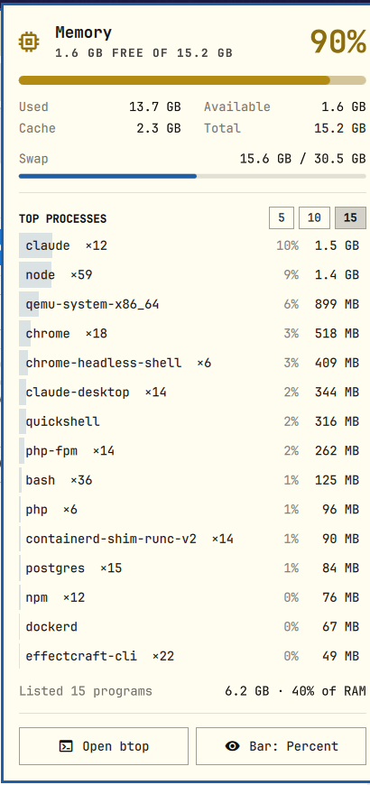

# Memory for the Omarchy bar

RAM in the [Omarchy](https://omarchy.org) bar, with a popup that shows where it went.



Bar: `󰍛 3.0G` — free memory by default. Left click opens the popup, right click cycles the
label (free → used → percent → icon only), middle click opens btop.

## What the popup shows

- used %, a usage bar (solid = used, faint = cache) and used / available / cache / total
- swap
- the programs holding the most RAM: 5, 10 or 15 rows, grouped by program (all
  `claude-desktop` helpers are one row with `×14`), each with its share of total RAM
- **stop a program**: hover a row, click `×`, then **Stop** (SIGTERM to the whole row). If it is
  still running ~3 s later the row offers **Force** (SIGKILL). The widget keeps no list of
  "important" processes: whatever the kernel refuses shows up as `Not allowed · system (root)`.

Keys: `Esc` close · `Enter`/`b` btop · `m` cycle label · `r` refresh · `+`/`-` more/fewer rows · `Tab` next panel.

## Colours follow your theme

| Memory used | Colour |
|---|---|
| below `cautionPercent` (75) | the theme's accent (in the bar: the normal text colour) |
| from `cautionPercent` | the theme's yellow |
| from `warnPercent` (90) | the theme's red |

The popup takes its text and background from the theme's popup colours and holds every colour to
WCAG contrast against that background — a yellow that reads on a dark popup is unreadable on a
cream one, so it is darkened until it is not.

## Settings

On the widget entry in `~/.config/omarchy/shell.json`:

```json
{ "id": "ismoil.memory", "display": "free", "cautionPercent": 75, "warnPercent": 90, "interval": 3, "topProcesses": 10 }
```

or `omarchy bar set ismoil.memory display percent`.

## Install

```sh
omarchy plugin add https://github.com/ismoil77/omarchy-memory --enable
```

## Tests

```sh
tests/run.sh
```

Node tests for `Model.js` (summary, thresholds, labels, process and kill parsing), for
`Contrast.js` against every stock theme, and for `kill-group.sh` against real processes;
the same libraries run in Qt's engine with `qmltestrunner`; then `omarchy plugin validate`.

MIT
