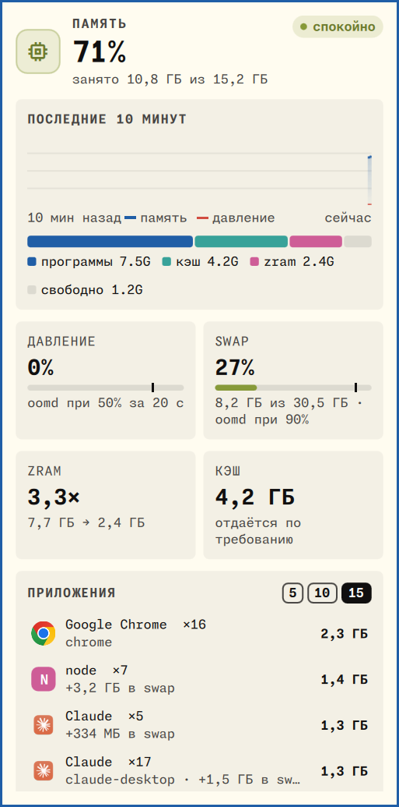

# Память в баре Omarchy

[English](README.md)

Память в баре [Omarchy](https://omarchy.org) и окно, которое отличает **спокойно** от **опасно** так
же, как это делает systemd-oomd: не по «90% занято» (для Linux это нормально), а по тому, ждут ли
программы память и кончается ли swap.



- **вердикт** и причина
- **последние 10 минут**: занятая память и давление как доля черты oomd
- **из чего состоит память**: программы, кэш, zram, свободно
- **давление** и **swap** рядом с чертами oomd, скорость swap
- **zram**: сколько сжато
- **кэш** и кнопка **Освободить**: ядро выбрасывает только кэш файлов, без swap и без root
- **приложения** с иконками, сколько у каждого лежит в swap, пометка **↑ растёт**; строку можно
  **раскрыть** (вкладки браузера, скрипты по проектам) и **остановить** целиком или по частям
- уведомление, когда память близко к черте oomd

Когда окно закрыто, виджет не запускает **ни одного процесса**: раз в 3 секунды он перечитывает
файлы ядра.

## Установка

```sh
omarchy plugin add https://github.com/ismoil77/omarchy-memory --enable
```

## Удаление

```sh
omarchy plugin remove ismoil.memory
```

## Лицензия

MIT
